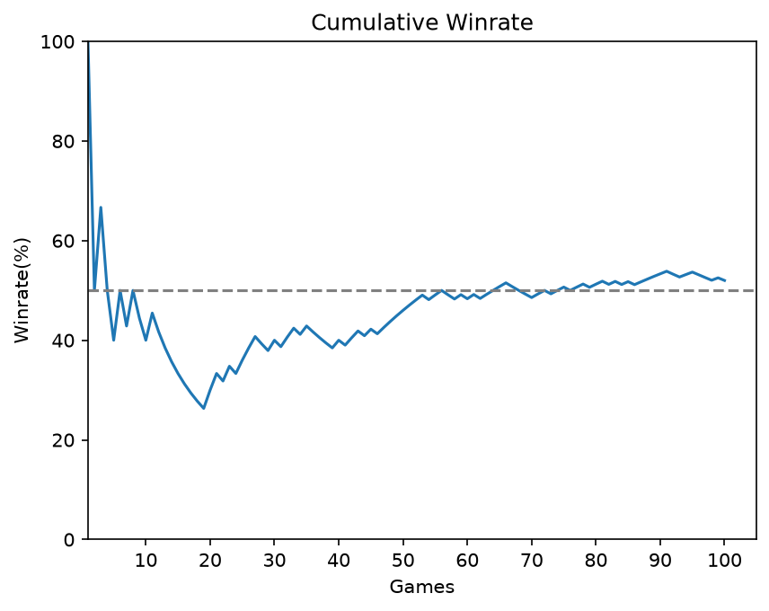
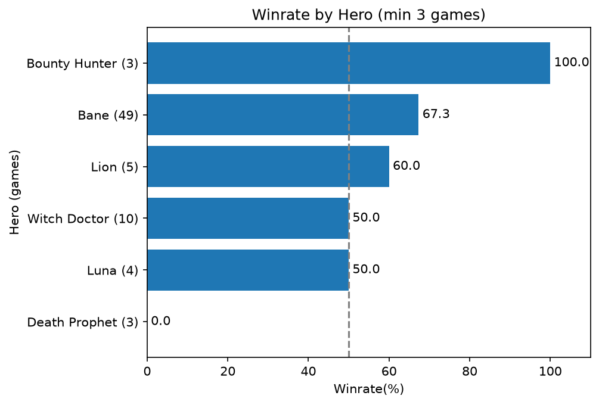
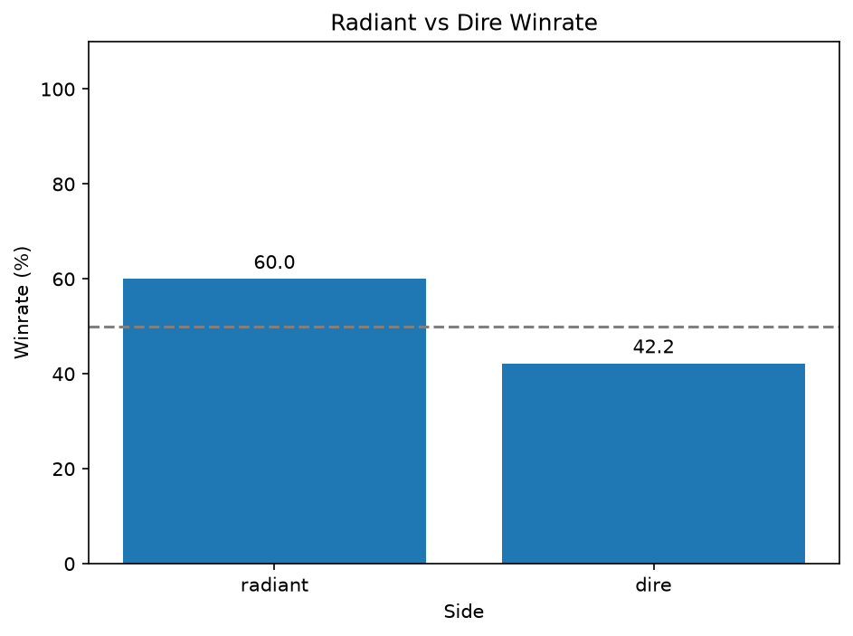
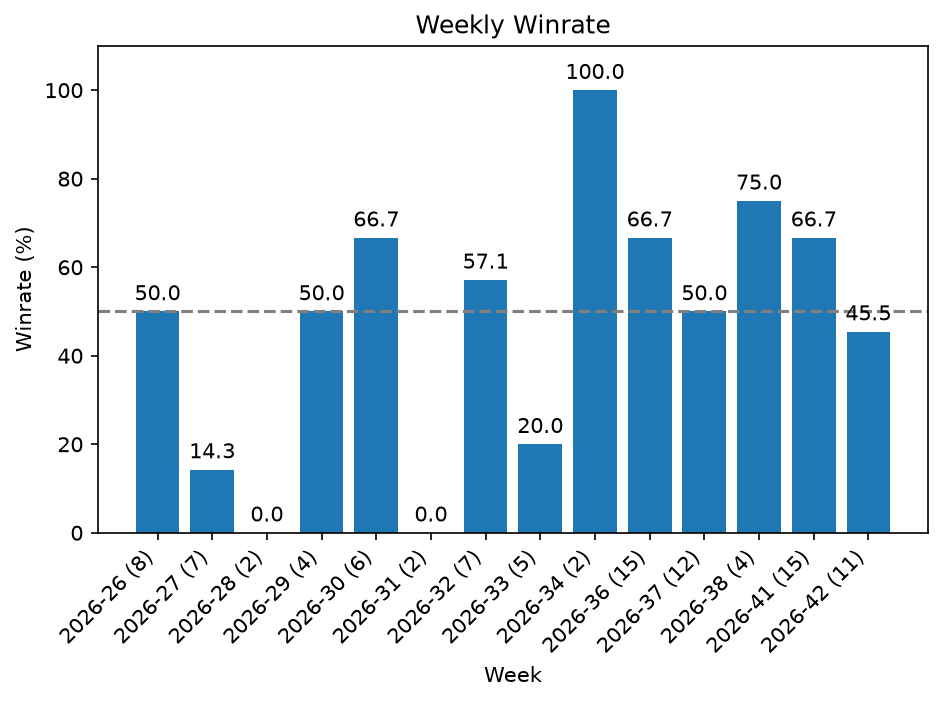
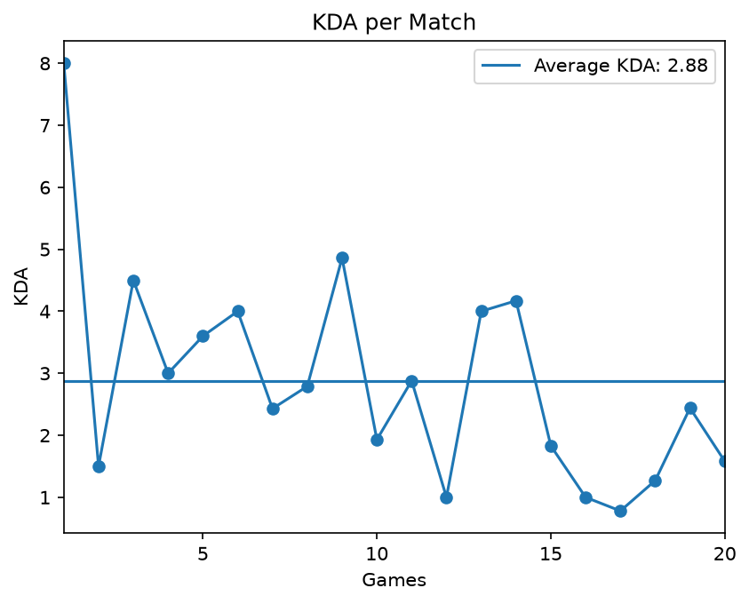

# Dota 2 Stats Tracker

A personal analytics pipeline for Dota 2 matches. It pulls match history from the [OpenDota API](https://docs.opendota.com/), stores it in a local SQLite database, analyzes performance with SQL and pandas, and generates charts with matplotlib.

The goal is to answer practical questions about my own games: which heroes actually work for me, whether the side of the map matters, and how my form changes over time. It works for any public Dota 2 account, and each account gets its own database and charts.

## Key findings

Based on my last **100 matches** (late June – mid October 2026):

- **Overall winrate is 52%**, but the path there wasn't smooth: after the first 19 games the cumulative winrate dropped to **26%**, then climbed steadily and got back above 50% only around game 55.
- **Side matters a lot:** **60.0%** winrate on Radiant (55 games) vs **42.2%** on Dire (45 games), an 18-point gap.
- **Bane is my strongest pick by volume:** 49 games (half of all matches) with a **67.3%** winrate. Witch Doctor, the second most played hero (10 games), sits at 50%.
- **Average KDA is 2.67**, and the average match lasts **39 minutes**.

## Charts

### Cumulative winrate
How the overall winrate evolved match by match.



### Winrate by hero
Only heroes with at least 3 games, so single lucky matches don't distort the picture. The number in brackets is the games played.



### Radiant vs Dire



### Weekly winrate
The number in brackets is the games played that week, so low-volume weeks can be read with care.



### KDA over the last 20 matches
Oldest match on the left, most recent on the right.



## Features

- **Incremental updates:** every run adds only new matches to the database, so the history keeps growing beyond the API limit of a single request.
- **Multiple accounts:** each account ID gets its own database (`dota_<id>.db`) and its own charts folder (`output/<id>/`), so stats never mix.
- **Offline mode:** with `UPDATE_DATA = False` the charts are built from the local database without calling the API.
- **Error handling:** network failures, timeouts and bad API responses stop the script with a clear message instead of a traceback.

## Tech stack

- **Python** — data collection and orchestration
- **REST API** (`requests`) — OpenDota API, with timeouts and error handling
- **SQLite** — local storage with duplicate protection
- **SQL** — `JOIN`, `GROUP BY` / `HAVING`, `CASE WHEN`, window functions, CTEs
- **pandas** — data preparation and metrics
- **matplotlib** — charts

## How it works

```
OpenDota API → api.py → SQLite (db.py) → SQL queries (sql/*.sql) → pandas → charts (charts.py) → output/<id>/*.png
```

1. `main.py` reads the account ID from `.env` and opens that account's database.
2. If `UPDATE_DATA` is on, `api.py` requests the latest matches and the hero list from OpenDota.
3. `db.py` saves them into SQLite. `match_id` is the primary key with `INSERT OR IGNORE`, so re-running the script never creates duplicates.
4. Each analysis lives in its own `.sql` file and is loaded into a DataFrame with `pd.read_sql`.
5. `charts.py` saves every result as a PNG in the account's folder.

### SQL highlights

- **Win detection in one expression:** `(player_slot < 128) = radiant_win` returns 1 for a win and 0 for a loss, so `AVG(...)` gives the winrate directly.
- **Cumulative winrate** with a named window: `SUM(...) OVER w` / `COUNT(*) OVER w`, where `w` is `ROWS BETWEEN UNBOUNDED PRECEDING AND CURRENT ROW`.
- **Hero stats** filtered with `HAVING COUNT(*) >= 3` to drop small samples.
- **KDA** computed safely with `MAX(deaths, 1)` (no division by zero) and `* 1.0` (no integer division).

## Project structure

```
statz/
├── api.py            # OpenDota requests + error handling
├── db.py             # SQLite tables, inserts, query runner
├── stats.py          # pandas metrics (winrate, side winrate, KDA, duration)
├── charts.py         # matplotlib charts
├── main.py           # entry point, settings (UPDATE_DATA)
├── sql/              # one analysis query per file
├── queries.sql       # SQL sandbox
├── output/<id>/      # generated charts for each account
├── dota_<id>.db      # local database for each account (not in the repo)
└── requirements.txt
```

## How to run

1. Clone the repo and create a virtual environment:
   ```bash
   git clone https://github.com/lilgothangel/statz.git
   cd statz
   python -m venv .venv
   source .venv/bin/activate      # Windows: .venv\Scripts\activate
   pip install -r requirements.txt
   ```
2. Copy `.env.example` to `.env` and set your Dota 2 account ID:
   ```
   DOTA_ACCOUNT_ID=123456789
   ```
   You can find it in your OpenDota profile URL: `opendota.com/players/<account_id>`. Match history must be public in your Dota 2 settings.
3. Run:
   ```bash
   python main.py
   ```
   The first run downloads your last 100 matches. Charts are saved to `output/<account_id>/`.

### Settings

- **`UPDATE_DATA`** in `main.py`: `True` downloads new matches before the analysis, `False` works only with the local database.
- **Another account:** change `DOTA_ACCOUNT_ID` in `.env` and run again. A separate database and charts folder will be created for it; your own data stays untouched.
- **`SHOW_SUMMARY`** / **`SUMMARY_MATCHES`** in `main.py`: print a short stats summary to the console and choose how many latest matches it covers.

## Possible improvements

- Track matches automatically on a schedule to grow the dataset over months.
- Add GPM/XPM and lane data (available via OpenDota's `project` parameter).
- Compare two accounts on the same charts.
- Build an interactive dashboard in Tableau Public on top of the SQL results.